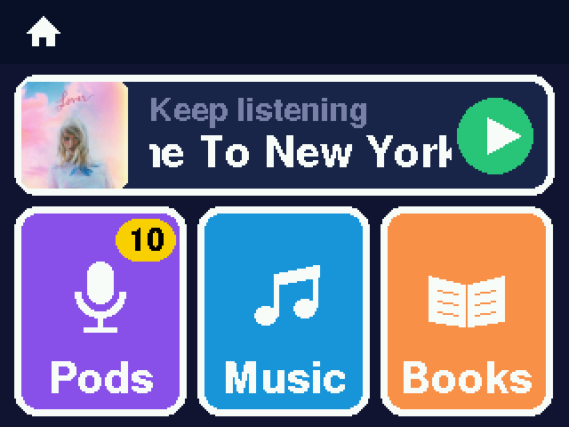
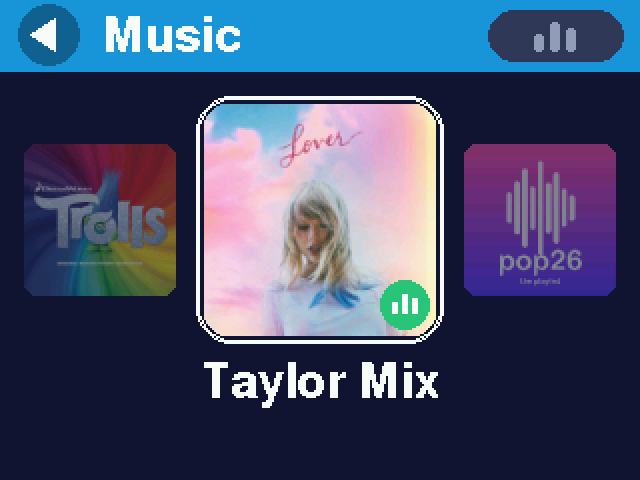
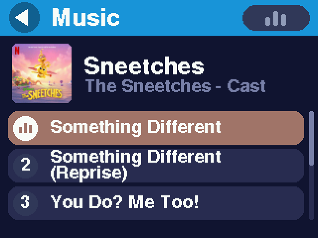
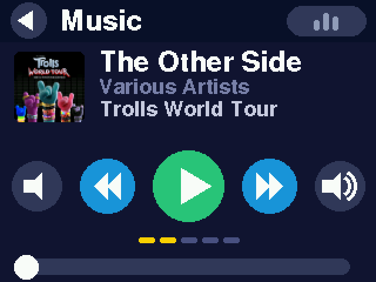

# Tiny Tunes

A kids' audio player for the [M5Stack Core2](https://docs.m5stack.com/en/core/core2): music,
audiobooks and podcasts from a microSD card, played on the speaker or Bluetooth headphones.
Built for a 5- and a 7-year-old: big pictures, few words, no browsing the internet, and
everything on it chosen by a grown-up.

| Home | Albums | Songs | Player |
|---|---|---|---|
|  |  |  |  |

## Using it

- **Home** (the middle touch button below the screen) shows the shelves side by side:
  Pods (podcasts, with a yellow badge counting the new episodes), Music and Books.
  Above them, **Keep listening** has whatever was playing last (a long title scrolls):
  one tap carries on and opens the player.
- **Albums** are a carousel of covers: swipe left and right, round and round. The ones
  played most recently come first. Tap the middle one to open it.
- **Songs** play when tapped; the list stays put. Tap the song that's playing for the
  player.
- **Books** skip the list and open the player where the story left off. Its bar covers the
  whole book, with a tick between chapters.
- **The player** has quieter / previous / play / next / louder, and a bar to drag. Swipe
  for the next or previous track.
- **The top bar** has back on the left, the shelf's name, and on the right the
  now-playing button: its bars bounce on green while something plays; tap it for the
  player. Home doesn't have it (Keep listening does that job): leaving Home for a shelf,
  Keep listening's green button flies up into the corner and becomes it. On
  a shelf's albums the bar is in the shelf's color.
- **Snackbars** at the bottom say when the battery is low, it's charging, or headphones
  connect. When headphones disconnect, the sound pauses rather than carrying on out
  loud.
- **The power button:** a tap turns the screen off and on (the sound keeps playing);
  holding it for a second switches Tiny Tunes off.

## For grown-ups

Hold two of the touch buttons below the screen for 3 seconds for the grown-ups screen:
the loudest the volume goes, brightness, auto-off, Bluetooth pairing, switching to WiFi
mode, and stats.

**Bluetooth and WiFi.** The ESP32 can't fit Bluetooth audio and WiFi at once, so Tiny Tunes
is two firmwares in the two app slots, and switching between them reboots (a couple of
seconds; the card and settings are shared):

- **Bluetooth mode** (normal): plays to paired headphones or speakers, or the speaker.
- **WiFi mode:** a web page for adding and organizing music, books and podcasts; podcast
  downloads; the clock set from the internet.

Every night between midnight and 5 am, if it's plugged in and nobody is using it, it
switches to WiFi by itself, downloads new podcast episodes, and switches back.

**A name.** `upload.py --name Ava` (or the web page's Settings) puts "Hi, Ava!" on the
splash screen and makes the web page `http://ava-tunes.local` in WiFi mode.

## Adding music, books and podcasts

The card is FAT32. Each top-level folder is a shelf, and each folder in it is an album:

```
/music/Fleetwood Mac - Rumours/01 Dreams.mp3
/music/Fleetwood Mac - Rumours/cover.jpg              (optional)
/books/The Wonderful Wizard of Oz/01 The Cyclone.mp3
/podcasts/Circle Round/2026-10-21 The Clever Fox.mp3  (managed by the podcast sync)
```

Names come from the songs' ID3 tags (title, artist, album, track and disc numbers) where
they have them, and from the file and folder names otherwise. Covers come from a
`cover.jpg` / `.png` in the folder, or from the picture inside the songs. Books and podcasts
remember where they were.

Three ways to add things:

- **Card reader:** copy the folders over. Changes show up the next time it's switched on.
- **The web page** (WiFi mode): drag in MP3s and a cover; rename, move and delete; Clean
  up tidies names and makes missing covers; add podcast feeds (RSS or Apple Podcasts
  links) and choose how many episodes to keep.
- **`upload.py`** over USB (or WiFi when the device is in WiFi mode):

```sh
PY=~/.venvs/esp/bin/python
$PY upload.py "~/Music/Some Artist - Some Album"           # an album folder
$PY upload.py --shelf books "~/Audiobooks/Charlotte's Web"   # a book
$PY upload.py --ls                                         # what's on the card
$PY upload.py --wifi MyNetwork                             # WiFi setup (asks for the password)
$PY upload.py --mode wifi                                  # switch to WiFi (or bt) mode
$PY upload.py --name Ava                                   # whose Tiny Tunes it is
```

Each run of `upload.py` also sets the device's clock from the computer.

**Fixing names.** If songs show the wrong title, artist or album, fix their tags with a
spreadsheet (the card in the Mac):

```sh
$PY tags.py export "/Volumes/NO NAME" tags.csv   # every song's tags, one row each
# edit tags.csv in Numbers or Excel
$PY tags.py apply "/Volumes/NO NAME" tags.csv    # shows what would change, then asks
```

(`~/.venvs/esp/bin/pip install mutagen` once first.)

## Building and flashing

Needs [arduino-cli](https://arduino.github.io/arduino-cli/), the Espressif ESP32 core
(tested with 3.3.12), these libraries, and a Python venv for the tools:

```sh
arduino-cli config add board_manager.additional_urls https://espressif.github.io/arduino-esp32/package_esp32_index.json
arduino-cli core install esp32:esp32
arduino-cli lib install M5Unified ESP8266Audio
git clone https://github.com/pschatzmann/ESP32-A2DP ~/Documents/Arduino/libraries/ESP32-A2DP
python3 -m venv ~/.venvs/esp && ~/.venvs/esp/bin/pip install esptool pyserial mutagen
```

```sh
./flash.sh                     # build both firmwares and flash them to the Core2 on USB
./flash.sh /dev/cu.usbserial-X # a particular one, when two are plugged in
./flash.sh --no-build          # flash the last build again
```

`test/run.sh` runs the tests for the title and tag code on the computer (needs a C++17
compiler, such as the one in Xcode's command line tools).

The version (grown-ups → Stats, and the web page's footer) is `VERSION` plus the build
number and commit, e.g. `0.9.3+32.08831bd`.

## Files

- `tiny-tunes.ino`: the firmware, both modes (`#if CORE2_WIFI`), including the web
  page and the USB serial protocol (documented above `handleSerial()`).
- `tt_text.h`: title clean-up and the ID3 tag reader, kept apart so `test/run.sh` can
  test them on a computer.
- `upload.py`: uploads, WiFi setup, mode switching, naming.
- `tags.py`: export song tags to a spreadsheet and write the edits back.
- `screenshot.py`: screenshots from the device's display (`--tour docs/screenshots` makes
  the ones above).
- `flash.sh`: builds both firmwares and flashes them.
- `CHANGELOG.md`: what changed in each version.
- `AGENTS.md`: working notes and constraints for AI coding agents.
